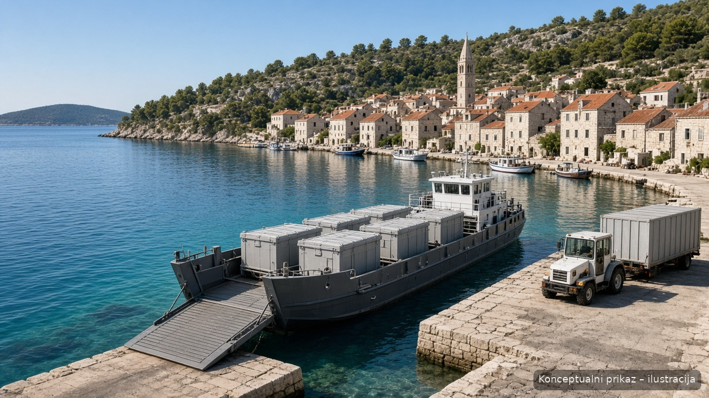

# Galleon Marine AI — Techlanica / TSO-36

Public documentation for **TSO-36** — a compact self-propelled marine barge (*teglenica*) for closed-container waste logistics between Dalmatian islands and the Split mainland transfer chain. Ships are conceived for **local build in the Split / Trogir shipbuilding corridor** (Techlanica context), drawing on Dalmatian yard heritage rather than ornamental design.

**Author & project lead:** Maciej Grajczyk (*autor i voditelj projekta*) · Galion Studio ([galion.studio](https://galion.studio) · [galion.app](https://galion.app))

> **Out of scope for this repository:** power-plant / *energana* engineering, inland energy-recovery plant siting, and any data-centre or floating-compute concepts. Those topics live elsewhere and are intentionally **not** mirrored here.

*Konceptualni prikaz — ilustracija. Island call with closed containers; not a class or construction drawing.*

---

## Status

Concept / **pre-FEED**. Not a class-society approved design, not a construction or environmental permit, and not a financing offer. Figures in the source PDFs are indicative discussion drafts.

---

## What this repo covers

| Topic | Content |
|---|---|
| **Vessel** | Compact self-propelled barge for **9 closed containers** per trip; bow ramp; industrial Dalmatian lines |
| **Crew** | 3 (master + 2) |
| **Fleet** | Plan for **two** identical TSO-36 units (serial / tender pair) |
| **Island chain** | Brač, Hvar, Šolta, Vis (+ Čiovo/Okrug–Trogir, Drvenik Veli/Mali as preferred weekly calls) |
| **Island handling** | Compactors → DIN 30722 closed containers (no press on the vessel) |
| **Build region** | Split / Trogir shipbuilding heritage — local yard capability for steel barge work |
| **Example line** | Vis / Komiža → Split transfer port (studied in the technical plan) |

---

## Documents

### Sources (PDF foundation)

| File | Role |
|---|---|
| [sources/Tehnicki_plan_teglenica_SDZ_v3.pdf](sources/Tehnicki_plan_teglenica_SDZ_v3.pdf) | **Current** technical plan (v3) — two TSO-36 barges, island compactors, land logistics |
| [sources/Tehnicki_plan_teglenica_SDZ_v2.pdf](sources/Tehnicki_plan_teglenica_SDZ_v2.pdf) | Prior technical plan (v2), kept for history |
| [sources/Konceptualni_prikazi_oznaceno.pdf](sources/Konceptualni_prikazi_oznaceno.pdf) | Labelled conceptual visuals (barge / pier / logistics chain) |

### Media

| File | Role |
|---|---|
| [media/02_teglenica_otocno_pristaniste_oznaceno.jpg](media/02_teglenica_otocno_pristaniste_oznaceno.jpg) | Island pier / barge handling concept (labelled) |

### Docs index

See [docs/INDEX.md](docs/INDEX.md) for a short reading order and how the PDFs map to the public narrative.

Start with **v3**. If a number in a PDF disagrees with this README, the PDF wins.

---

## Related public repo

A parallel public pack also exists at [galion-studio/Teglenica-TSO-36](https://github.com/galion-studio/Teglenica-TSO-36). This **Galleon Marine AI** repository is the Galion Studio satellite focused on the **ship / Techlanica** story for Split–Trogir local build, without plant or data-centre material.

---

## Licence

[MIT](LICENSE) © 2026 Maciej Grajczyk / Galion Studio
